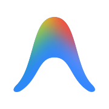
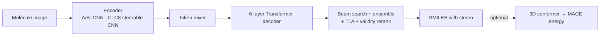

<p>
  <a href="https://antigravity.google/"></a>
  <sub>This project uses API credits from the Google Antigravity for Science program. Thank you, Google Antigravity!</sub>
</p>
<br clear="left">

<div align="center">
<picture>
  <source media="(prefers-color-scheme: dark)" srcset="assets/ouroboros-ocsr_mark_dark.svg">
  
</picture>

# Ouroboros

**Read a molecule drawing, get the SMILES back, at any rotation.**

[](LICENSE)
[](pyproject.toml)
[](https://github.com/yaniguan/ouroboros-ocsr/actions/workflows/tests.yml)

</div>

## What it does

Ouroboros is optical chemical structure recognition (OCSR): it turns an image of a molecule into a SMILES string, stereochemistry included. Its main encoder is a C8 steerable CNN, so a rotated drawing gives rotated features by construction instead of by data augmentation. A fine-tuned ensemble now reads **54.0%** of 298 real figures from papers and patents exactly.

## Quickstart

Python 3.11 and a Fortran compiler (`gfortran`) are needed for `escnn`. No GPU or dataset needed.

```bash
git clone https://github.com/yaniguan/ouroboros-ocsr.git && cd ouroboros-ocsr
python3.11 -m venv .venv && source .venv/bin/activate
pip install -r requirements-inference.txt
python scripts/prepare_inference.py
pip install --no-deps -e .
python -m ouroboros.weights fetch --arm C          # downloads + SHA256-checks checkpoints/ouroboros-C.pt
```

```python
from ouroboros.demo.rotation import RotationLab

lab = RotationLab.from_checkpoint("checkpoints/ouroboros-C.pt")    # C8 steerable encoder
for angle in (0, 90, 180):
    r = lab.evaluate("CC(=O)Oc1ccccc1C(=O)O", angle=angle)         # draw aspirin, rotate it
    print(angle, r["rotated_prediction"]["smiles"], "feature error:", r["feature_error"])
```

```text
0 CC(=O)Oc1ccccc1C(=O)O feature error: 3.1e-16
90 CC(=O)Oc1ccccc1C(=O)O feature error: 8.1e-07
180 CC(=O)Oc1ccccc1C(=O)O feature error: 8.1e-07
```

Want a UI?
- **Full Physics & Equivariance Workbench (`ouroboros.ui`):** `python -m ouroboros.ui --port 8787` launches an interactive 6-tab web workbench covering visual OCSR (`A/B/C/AC/ABC`, beam search, TTA, confidence gates), 2D $C_N$ rotation & chiral mirror equivariance probes, interactive 3D equivariant molecule generation with a **10-gate physical compliance audit** (valence/topology, charge/spin domain, CIP stereo, ETKDGv3, Pauli steric clearance, covalent geometry, 3D chirality retention, LBFGS stationary convergence, live $SE(3)$ rotation/translation + Noether momentum conservation, and $O(3)$ parity + conservative $\mathbf{F} = -\nabla_{\mathbf{R}} E$ finite-difference verification), 3D error propagation, force-field `extxyz` dataset building, and batch evaluation ([guide](docs/physics-workbench.md)).
- **Minimal 2D Rotation Demo (`ouroboros.demo`):** `python -m ouroboros.demo --checkpoint checkpoints/ouroboros-C.pt` opens a lightweight rotation lab ([guide](docs/rotation-demo.md)).

## Key features

- **Rotation-aware encoder.** C8 steerable CNN (arm C) next to a CNN baseline without (A) and with (B) rotation augmentation, same decoder and budget.
- **Stereo-aware SMILES.** Exact match is scored with full stereochemistry after RDKit standardization.
- **Strong decoding.** Beam search, RDKit-validity reranking, multi-model ensembles and test-time augmentation in [`scripts/predict_real.py`](scripts/predict_real.py).
- **One scoring harness.** Exact match, stereo-free match, InChIKey, Tanimoto and bootstrap CIs in [`scripts/eval_predictions.py`](scripts/eval_predictions.py).
- **Leakage check.** [`scripts/check_leakage.py`](scripts/check_leakage.py) fails if any test molecule's InChIKey appears in a training set.
- **Verified weights.** Release checkpoints are fetched with SHA256 checks.

## Results

Real images: 298 figures (ACS 100, UOB 100, USPTO 98), a seeded sample of public OCSR benchmarks. Exact match with stereochemistry.

| Model | All | ACS | UOB | USPTO | Source |
|---|---|---|---|---|---|
| **A + C ensemble, beam 5 + TTA** | **54.0%** (CI 48.3–59.7) | **40%** | **84%** | **37.8%** | [`benchmarks/finetune-v2-oct30/AC-ensemble-beam5-ttapad-report.md`](benchmarks/finetune-v2-oct30/AC-ensemble-beam5-ttapad-report.md) |
| A + C ensemble, beam 5, no TTA | 52.4% (CI 46.6–58.1) | 37% | 85% | 34.7% | [`benchmarks/finetune-v2-oct30/AC-ensemble-beam5-report.md`](benchmarks/finetune-v2-oct30/AC-ensemble-beam5-report.md) |
| A alone, greedy | 51.0% | 38% | 84% | 30.6% | [`benchmarks/finetune-v2-oct30/A-selected-report.md`](benchmarks/finetune-v2-oct30/A-selected-report.md) |
| C alone, greedy | 37.6% | 20% | 74% | 18.4% | [`benchmarks/finetune-v2-oct30/C-selected-report.md`](benchmarks/finetune-v2-oct30/C-selected-report.md) |

Made by [`colab/finetune_v2.ipynb`](colab/finetune_v2.ipynb) (real-data fine-tune v2 of arms A and C) with `scripts/predict_real.py` and `scripts/eval_predictions.py`. Synthetic rotation results for the v0.1.0-alpha checkpoints: [`docs/v0-results.md`](docs/v0-results.md) and [`benchmarks/v0.1.0-alpha/`](benchmarks/v0.1.0-alpha/).

Published systems report higher numbers on the full benchmark sets with their own scoring; our sample is small (95% CIs of about ±10 points per source) and scoring parity is not verified.

## How it works



| Arm | Image encoder | Random rotation in training |
|---|---|---|
| A | ResNet-style CNN + absolute positions + Transformer mixer | No |
| B | Same as A | Yes, uniform 0–360° |
| C | C8 steerable CNN + invariant token-set mixer | No |

## Repo layout

```
ouroboros/    package: data/ (rendering, real data), encoder/, decode/, eval/, geometry/, train/, demo/
scripts/      predict, evaluate, build data, profile, export weights
configs/      training configs (pilot-{A,B,C}-200k.yaml, ...)
colab/        GPU notebooks (fine-tune v2, real-data fine-tunes)
notebooks/    setup, data, training, geometry, rotation demo
benchmarks/   measured results, one folder per experiment
docs/         results, release notes, research plan, roadmap
tests/        pytest suite
```

## Limitations / status

- **Research preview.** The GitHub release (v0.1.0-alpha) ships the synthetic-only A/B/C checkpoints. The fine-tuned v2 checkpoints behind the 54.0% result are not released yet.
- **Weak spots on real figures:** stereochemistry (18% exact on the 49 images with stereo), long patent molecules, and R-groups / abbreviations (ACS).
- On upright real figures arm A beats arm C (51.0% vs 37.6% greedy); the rotation prior pays off on rotated drawings.
- C8 is a discrete rotation prior; rasterization means predictions need not match at every angle.
- Hand-drawn structures are not measured yet. Optional 3D/MACE tools are outside the release scope ([DATA.md](DATA.md)).

Weights and provenance: [MODEL_CARD.md](MODEL_CARD.md). Training protocol: [docs/v0-release.md](docs/v0-release.md). History: [TASK.md](TASK.md), [CHANGELOG.md](CHANGELOG.md).

## Optional tools

Use `--ink-crop` with [`scripts/ingest_real.py`](scripts/ingest_real.py) or [`scripts/image_to_forcefield.py`](scripts/image_to_forcefield.py) `--images` to remove white padding before resizing. It keeps all marks darker than `--ink-threshold` (default 250), with `--ink-margin` pixels of padding (default 8, before resizing). Blank images keep their size. Cropping is off by default. Use the same settings when preparing training images and making predictions.

To check ranked candidates, export them with [`scripts/predict_real.py`](scripts/predict_real.py) `--nbest-out candidates.jsonl`, then run [`scripts/eval_nbest.py`](scripts/eval_nbest.py) `candidates.jsonl --k 1 3 5`. The report uses unique standardized molecules. For each subset, it checks for the correct molecule among the top candidates, with and without stereochemistry. It also counts cases where the correct candidate was not selected.
Prediction checks are off by default. [`scripts/predict_real.py`](scripts/predict_real.py) `--min-margin 0.2 --max-disagreement 0` adds acceptance fields and keeps the predicted molecule. The margin is the score gap between distinct molecules after standardization. Missing alternatives, or scores that are missing, infinite, or NaN, leave the margin unknown. Agreement checks keep stereochemistry. They do not give the probability that a prediction is correct. Run [`scripts/eval_selective.py`](scripts/eval_selective.py) `validation.jsonl --margins 0 0.2 0.5` on validation data with ranked candidates to see how many predictions pass and how often they are correct before choosing limits. [`scripts/image_to_forcefield.py`](scripts/image_to_forcefield.py) `--respect-confidence` reads acceptance fields from the predictions CSV. Rows with rejected or missing acceptance get a manifest record without geometry.
[`scripts/image_to_forcefield.py`](scripts/image_to_forcefield.py) `--expand-aliases` expands Me, Et, OMe, OEt, Ph, Boc, CO2Me and CO2Et before making 3D coordinates. Each alias must have one single bond to one other atom. Generic R groups and unknown aliases are still rejected. The manifest saves the input, recognized, expanded and standardized structures. Expansion is off by default and does not guess what R groups mean.
Geometry checks are off by default. Use `--geometry-eligibility` to reject molecules with net charge, radicals, or unsupported elements before embedding or labeling. The calculator must list its supported elements, or you must supply them with `--allowed-elements H C N O ...`. Checks include implicit hydrogens. Use `--require-assigned-stereo` to also reject unassigned tetrahedral or double-bond stereo. Either extra flag turns on the checks. Checks run after standardization. Neutral groups with separate charges, such as nitro, are allowed. The manifest lists all reasons a molecule was rejected.
To create train, validation, and test files, run [`scripts/split_forcefield.py`](scripts/split_forcefield.py) `--frames data.extxyz --manifest data.manifest.jsonl --out-dir splits --seed 0`. The same seed gives the same split for each molecule, regardless of input order. All conformers, equivalent SMILES, and stereoisomers stay together. The default fractions are 0.8/0.1/0.1. Use `--fractions` to change them. Small datasets may have empty splits. Molecules with the same connectivity stay in one split. Related molecular scaffolds may still appear in different splits. Output manifests keep the frame matches and indices. Skipped inputs have a separate manifest. Missing or duplicate frame matches cause an error. The output directory must be empty.
[`scripts/image_to_forcefield.py`](scripts/image_to_forcefield.py) `--displaced-samples 3 --max-displacement 0.1` tries three random coordinate changes for each ETKDG conformer, then computes energies and forces. The seed makes the changes repeatable. Each atom moves at most 0.1 Angstrom. Samples are rejected if atoms are closer than `--displacement-min-distance` (default 0.6 Angstrom) or if specified stereochemistry changes. Rejected samples are not retried. The manifest records all attempts and sampling settings. Frames and conformers include parent and sample IDs. Sample zero is the original. Sampling is off by default and cannot be used with relaxation. Whether these extra samples improve force-field training has not been tested.

## Citation

```bibtex
@misc{ouroboros2026,
  title  = {Ouroboros: Rotation-Equivariant Optical Chemical Structure Recognition with Stereochemistry},
  author = {Guan, Yani},
  year   = {2026},
  url    = {https://github.com/yaniguan/ouroboros-ocsr},
  note   = {v0.1.0-alpha research preview}
}
```

## License

Code: MIT, see [LICENSE](LICENSE). Weights and dependency provenance: [MODEL_CARD.md](MODEL_CARD.md).
